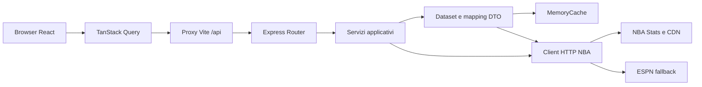

# NBA Dashboard - Documentazione tecnica

Documento di riferimento del progetto, redatto in italiano e basato sul codice presente nel repository al 30 ottobre 2026. Le limitazioni descritte rappresentano il comportamento implementato, non funzionalita pianificate. Le versioni delle dipendenze indicate sono quelle dichiarate nei manifest, non necessariamente quelle risolte durante l'installazione.

## Indice

1. [Scopo e perimetro](#1-scopo-e-perimetro)
2. [Installazione e comandi](#2-installazione-e-comandi)
3. [Configurazione backend](#3-configurazione-backend)
4. [Confini HTTP e gestione errori](#4-confini-http-e-gestione-errori)
5. [Stack e architettura](#5-stack-e-architettura)
6. [Stagioni e fasi](#6-stagioni-e-fasi)
7. [Cache e aggiornamento](#7-cache-e-aggiornamento)
8. [Client HTTP e fonti esterne](#8-client-http-e-fonti-esterne)
9. [Riferimento API](#9-riferimento-api)
10. [Modello dati](#10-modello-dati)
11. [Servizi applicativi](#11-servizi-applicativi)
12. [Frontend](#12-frontend)
13. [Build e distribuzione](#13-build-e-distribuzione)
14. [Test e controlli](#14-test-e-controlli)
15. [Diagnosi e manutenzione](#15-diagnosi-e-manutenzione)
16. [Sicurezza e limiti](#16-sicurezza-e-limiti)
17. [Estensione del progetto](#17-estensione-del-progetto)
18. [Riferimenti e glossario](#18-riferimenti-e-glossario)

## 1. Scopo e perimetro

NBA Dashboard e una web app per consultare dati NBA tramite un backend Express e un frontend React. Il repository e un monorepo npm con due workspace, `backend` e `frontend`. Non richiede account o API key e non implementa autenticazione, database o persistenza server.

L'utilizzo previsto e locale. Questo non significa funzionamento offline: le fonti NBA e gli asset remoti richiedono accesso a Internet. Il codice non costituisce una configurazione pronta per l'esposizione pubblica.

Riferimenti principali: [README](../README.md), [manifest root](../package.json), [app Express](../backend/src/app.ts), [rotte API](../backend/src/routes/api.ts).

## 2. Installazione e comandi

Prerequisiti dichiarati: Node.js 22+, npm 10+ e accesso HTTPS alle fonti NBA.

Eseguire dalla root del repository:

```powershell
npm install
npm run dev
```

Lo script `dev` usa `concurrently --kill-others-on-fail` per avviare i due workspace e terminare gli altri processi in caso di fallimento di uno di essi.

| Comando root                        | Scopo                                      |
| ----------------------------------- | ------------------------------------------ |
| `npm run dev`                       | Avvio contemporaneo backend e frontend     |
| `npm run build`                     | Build backend, poi frontend                |
| `npm run typecheck`                 | Controllo TypeScript dei due workspace     |
| `npm run test`                      | Suite backend, poi frontend                |
| `npm run lint`                      | Esecuzione degli script lint dei workspace |
| `npm run test --workspace backend`  | Solo test backend                          |
| `npm run test --workspace frontend` | Solo test frontend                         |

Indirizzi di sviluppo predefiniti: frontend `http://127.0.0.1:5173`, backend `http://127.0.0.1:4001`. Le impostazioni effettive di binding e proxy sono descritte nelle sezioni successive.

## 3. Configurazione backend

La configurazione viene letta da `process.env` in [env.ts](../backend/src/config/env.ts).

| Variabile                | Default                                    | Significato                                     |
| ------------------------ | ------------------------------------------ | ----------------------------------------------- |
| `PORT`                   | `4001`                                     | Porta HTTP backend                              |
| `NBA_SEASON`             | Stagione calcolata dalla data UTC          | Override della stagione                         |
| `NBA_STATS_BASE_URL`     | `https://stats.nba.com/stats`              | Base degli endpoint statistici                  |
| `NBA_CDN_BASE_URL`       | `https://cdn.nba.com`                      | Base CDN NBA                                    |
| `NBA_LIVE_BASE_URL`      | `https://cdn.nba.com/static/json/liveData` | Base dei dati live                              |
| `NBA_REQUEST_TIMEOUT_MS` | `6000`                                     | Timeout delle richieste esterne in millisecondi |
| `NBA_REQUEST_RETRIES`    | `1`                                        | Numero di retry configurato nel client          |
| `NBA_CACHE`              | KV namespace binding                       | Cache L2 condivisa tra le istanze Worker        |
| `NBA_ALLOW_INSECURE_TLS` | Disabilitato                               | Attivo solo con `1` o `true`                    |

Esempio PowerShell, prima dell'avvio:

```powershell
$env:NBA_SEASON = "2025-26"
$env:PORT = "4001"
npm run dev
```

I parametri numerici sono convertiti tramite `Number`, senza validazione di intervallo in questo modulo. Il default della stagione usa settembre come mese di cambio anno sportivo: da settembre `YYYY-(YY+1)`, da gennaio ad agosto la stagione iniziata l'anno precedente.

Non e configurato un caricamento automatico di file `.env` nel backend: creare il file da solo non applica queste variabili. Usare l'ambiente del terminale o configurare esplicitamente il processo di avvio. Cambiare `PORT` richiede anche l'aggiornamento del target proxy Vite, che non legge questa variabile.

L'opzione TLS insicura e un workaround diagnostico temporaneo e non deve essere abilitata in un ambiente esposto o usata come soluzione permanente. Il client modifica `NODE_TLS_REJECT_UNAUTHORIZED` per l'intero processo; inoltre puo attivare automaticamente questa modalita dopo alcuni errori di certificato, anche senza l'override. Vedere la sezione sul client HTTP.

## 4. Confini HTTP e gestione errori

Express applica CORS con `origin: true`, accetta JSON fino a `1mb` e monta le rotte sotto `/api`. Non sono presenti controlli di autenticazione in [app.ts](../backend/src/app.ts).

Una rotta inesistente risponde con HTTP 404 e `{"error":"Not Found"}`. Il middleware degli errori restituisce `{"error":"messaggio","status":500}`, usando lo status numerico dell'errore quando disponibile, oppure 404 se il messaggio contiene `not found`, altrimenti 500. Lo stack non viene incluso nel JSON; il testo del messaggio viene invece restituito al chiamante.

`GET /api/health` non usa l'envelope dei dati: restituisce stato del processo, uptime, stagione e statistiche cache. Non verifica in tempo reale la raggiungibilita delle fonti NBA. Nei tre endpoint `/health`, `/seasons` e `/seasons/current` la fase esposta e attualmente la stringa fissa `regular-season`.

## 5. Stack e architettura

| Ambito    | Tecnologie dichiarate                                                                  |
| --------- | -------------------------------------------------------------------------------------- |
| Backend   | Express `^5.1.0`, CORS `^2.8.5`, Zod `^4.1.5`                                          |
| Frontend  | React e React DOM `^19.1.1`, React Router DOM `^7.8.2`, TanStack React Query `^5.87.4` |
| Toolchain | TypeScript `^5.9.2`, Vite `^7.1.3`, tsx `^4.20.5`, concurrently `^9.2.0`               |
| Test      | Vitest `^3.2.4`, Testing Library React `^16.3.0`, jest-dom `^6.9.1`, jsdom `^27.0.0`   |

I due workspace sono ES module (`type: module`). I manifest di riferimento sono [backend](../backend/package.json) e [frontend](../frontend/package.json).



La composizione avviene in [services.ts](../backend/src/modules/services.ts): `createServices(client)` crea i servizi con un client sostituibile e la cache condivisa. `createApp(services)` consente a sua volta di iniettare i servizi. Questa separazione permette test con dipendenze simulate senza eseguire il server.

### 5.1 Organizzazione

| Percorso                   | Responsabilita                                    |
| -------------------------- | ------------------------------------------------- |
| `backend/src/server.ts`    | Avvio HTTP, log e warmup                          |
| `backend/src/app.ts`       | Middleware Express e gestione errori              |
| `backend/src/routes/`      | Contratto HTTP e validazione input                |
| `backend/src/config/`      | Variabili d'ambiente, stagione, directory squadre |
| `backend/src/nba-client/`  | Richieste HTTPS a NBA ed ESPN                     |
| `backend/src/cache/`       | Cache volatile nel processo                       |
| `backend/src/modules/`     | Servizi di dominio e dataset condivisi            |
| `backend/src/types/dto/`   | Tipi di risposta e oggetti di dominio             |
| `backend/src/utils/`       | Mapping tabellare, date, numeri e URL asset       |
| `frontend/src/app/`        | Router client                                     |
| `frontend/src/pages/`      | Viste applicative                                 |
| `frontend/src/components/` | Layout, selettore, stati, tabelle e pannelli      |
| `frontend/src/lib/`        | Client API, tipi, formattazione e asset           |
| `frontend/src/styles/`     | Stili condivisi                                   |
| `frontend/src/test/`       | Setup e test frontend                             |
| `docs/`                    | Documentazione del progetto                       |

### 5.2 Ciclo di vita

[server.ts](../backend/src/server.ts) avvia Express sulla porta configurata, esegue subito il warmup e lo ripete ogni 45 secondi. Il warmup carica home, classifiche, playoff, squadre, giocatori, leader e calendario con `Promise.allSettled`; un flag impedisce la sovrapposizione di due warmup.

Il timer e `unref()` e viene rimosso su `SIGINT` e `SIGTERM`, seguiti da `process.exit(0)`. Non viene implementato un drenaggio delle richieste HTTP in corso. `app.listen(env.port)` non specifica un host: il log mostra loopback, ma il binding effettivo non e limitato esplicitamente a `127.0.0.1`.

## 6. Stagioni e fasi

[season.ts](../backend/src/config/season.ts) definisce `NBA_SEASON` una volta, all'import del modulo. `resolveSeason` applica un override non vuoto oppure inferisce la stagione dalla data UTC. `validateSeason` verifica sia il formato `YYYY-YY` sia la consecutivita degli anni. Un override non valido puo impedire l'avvio.

`getSeasonPhase` usa soglie convenzionali, non il calendario ufficiale degli eventi:

| Intervallo nella stagione                   | Fase             |
| ------------------------------------------- | ---------------- |
| 1 settembre - prima del 1 ottobre           | `preseason`      |
| 1 ottobre - prima del 1 novembre            | `regular-season` |
| 1 novembre - prima del 10 aprile successivo | `nba-cup`        |
| 10 aprile - prima del 15 aprile             | `play-in`        |
| 15 aprile - prima del 1 luglio              | `playoffs`       |
| Fuori dagli intervalli precedenti           | `offseason`      |

L'intervallo stagionale dei filtri va dal 1 ottobre al 31 luglio successivo. Lo spotlight della home passa da classifica a playoff dal 14 aprile. Queste soglie sono diverse e non devono essere interpretate come date ufficiali NBA.

### 6.1 Limite della selezione storica

`/api/seasons` elenca la stagione del processo e le cinque precedenti. La lista non garantisce la disponibilita dei relativi dati. Alcune rotte validano `season`, ma non la passano ai servizi; client e dataset continuano a utilizzare `NBA_SEASON`. Altre rotte ignorano il parametro del tutto.

Di conseguenza, cambiare stagione nella UI non realizza una selezione storica end-to-end. Per cambiare la stagione delle richieste statistiche e necessario impostare `NBA_SEASON` e riavviare il backend; anche cosi, scoreboard live, snapshot CDN e fallback ESPN non garantiscono dati storici coerenti.

Inoltre `SEASON_END_YEAR` e calcolato aggiungendo 2000 alle ultime due cifre: il supporto ad anni fuori dal secolo corrente non e generalizzato.

## 7. Cache e aggiornamento

[MemoryCache](../backend/src/cache/memoryCache.ts) contiene una `Map` di valori e una `Map` dei refresh in corso. Ogni elemento conserva `value`, `expiresAt` e `updatedAt`.

`getOrLoad(key, ttlMs, loader, allowStaleOnError = true)` si comporta cosi:

1. Con valore non scaduto restituisce subito `stale: false`.
2. Con valore scaduto e comportamento stale abilitato restituisce subito il valore precedente con `stale: true` e avvia un refresh in background.
3. I refresh in background della stessa chiave sono deduplicati; gli errori del refresh vengono assorbiti e il dato precedente resta disponibile.
4. Senza un valore utilizzabile esegue il loader, memorizza il risultato oppure propaga l'errore.

La deduplicazione non copre tutti i cache miss: due richieste contemporanee a cache vuota possono eseguire due loader. Non sono previsti limite di capacita, eviction periodica, storage persistente o cache condivisa fra processi. Le entry scadute rimangono nella mappa.

| Costante TTL | Durata     | Impiego previsto              |
| ------------ | ---------- | ----------------------------- |
| `live`       | 30 secondi | Scoreboard e dati live        |
| `standings`  | 2 minuti   | Classifiche                   |
| `stats`      | 10 minuti  | Statistiche e cataloghi       |
| `calendar`   | 10 minuti  | Calendario                    |
| `profile`    | 12 ore     | Profili e dettagli anagrafici |

Le chiavi sono definite nei singoli loader: alcune includono stagione, ID o data, altre sono costanti versionate, ad esempio `standings-dataset:v4-espn-fallback`. Non e quindi corretto considerarle tutte isolate per stagione.

Il TTL scaduto non genera da solo una richiesta: serve una lettura, eventualmente prodotta dal warmup. `/api/health` espone `entries`, `refreshInFlight` e `keys`. Per svuotare la cache occorre riavviare il backend; non esiste un endpoint di invalidazione.

## 8. Client HTTP e fonti esterne

[client.ts](../backend/src/nba-client/client.ts) espone `NbaApiClient` e `createNbaApiClient(fetchImpl)`. Il trasporto usa `fetch`, `AbortController`, header simili a un browser e parsing JSON. Le risposte HTTP non riuscite generano un errore con status upstream e URL nel messaggio.

Il timeout si applica al singolo tentativo. Con `NBA_REQUEST_RETRIES=1` sono normalmente previsti due tentativi; il backoff e `300 * numeroRetry` millisecondi. I retry non sono limitati a specifici status HTTP. L'eventuale tentativo dopo disabilitazione TLS non incrementa il contatore ordinario.

### 8.1 Comportamento TLS

Con override attivo, oppure al primo errore riconosciuto fra certificati scaduti, self-signed, issuer mancante e leaf signature non verificabile, il client imposta `process.env.NODE_TLS_REJECT_UNAUTHORIZED = "0"`. La modifica ha effetto sul processo, non solo sul dominio NBA. Un flag evita di ripetere l'attivazione; viene scritto un warning in console.

Questo e un rischio concreto della versione attuale: l'assenza dell'override non garantisce che la verifica TLS resti attiva. Per uso non locale occorre rimuovere il downgrade automatico e configurare una catena di certificati attendibile.

### 8.2 Recupero delle classifiche

[datasets.ts](../backend/src/modules/shared/datasets.ts) prova classifiche NBA e playoff picture in parallelo, con timeout applicativo pari ad almeno 6 secondi. Accetta il mapping primario quando contiene almeno 20 squadre e almeno una ha partite giocate.

In alternativa ricostruisce i record dallo snapshot del calendario. Se necessario prova ESPN sul 12 aprile dell'anno finale della stagione, una data fissa che non rappresenta necessariamente la classifica attuale. L'ultimo fallback usa la directory locale delle squadre.

Le classifiche ricostruite ordinano per vittorie, sconfitte e nome: non applicano l'intero regolamento NBA degli spareggi. I fallback possono contenere zeri, seed sintetiche e record `--`; non sono risultati ufficiali. Il flag `stale` della cache non identifica necessariamente tutti i fallback interni.

### 8.3 Mappa degli endpoint upstream

I percorsi NBA Stats sono relativi a `NBA_STATS_BASE_URL`; le richieste statistiche usano normalmente `LeagueID=00`, la stagione del processo e `SeasonType=Regular Season`. I game log possono richiedere anche `Playoffs`.

| Metodo del client          | Endpoint                                                    | Uso                                                            |
| -------------------------- | ----------------------------------------------------------- | -------------------------------------------------------------- |
| `getLiveScoreboard`        | Live base + `scoreboard/todaysScoreboard_00.json`           | Partite di oggi                                                |
| `getLiveBoxscore`          | Live base + `boxscore/boxscore_{gameId}.json`               | Dettaglio partita                                              |
| `getScheduleSnapshot`      | CDN base + `static/json/staticData/scheduleLeagueV2_1.json` | Calendario snapshot                                            |
| `getScoreboardByDate`      | Stats + `scoreboardv2`                                      | Calendario per `GameDate=MM/DD/YYYY`                           |
| `getPlayerIndex`           | Stats + `playerindex`                                       | Catalogo giocatori attivi                                      |
| `getLeagueDashPlayerStats` | Stats + `leaguedashplayerstats`                             | Medie giocatore, `PerMode=PerGame`                             |
| `getLeagueLeaders`         | Stats + `leagueleaders`                                     | Recupero alternativo statistiche, categoria default `PTS`      |
| `getCommonPlayerInfo`      | Stats + `commonplayerinfo`                                  | Anagrafica `PlayerID`                                          |
| `getPlayerGameLogs`        | Stats + `playergamelog`                                     | Game log `PlayerID`                                            |
| `getTeamInfoCommon`        | Stats + `teaminfocommon`                                    | Anagrafica squadra                                             |
| `getCommonTeamRoster`      | Stats + `commonteamroster`                                  | Roster `TeamID`                                                |
| `getLeagueDashTeamStats`   | Stats + `leaguedashteamstats`                               | Medie squadra                                                  |
| `getTeamGameLog`           | Stats + `teamgamelog`                                       | Game log squadra                                               |
| `getLeagueStandings`       | Stats + `leaguestandings`                                   | Classifiche                                                    |
| `getPlayoffPicture`        | Stats + `playoffpicture`                                    | Quadro qualificazione, `SeasonID=2` seguito dall'anno iniziale |
| `getEspnScoreboardByDate`  | ESPN base + `scoreboard?dates=YYYYMMDD`                     | Fallback risultati/record                                      |
| `getEspnRoster`            | ESPN base + `teams/{espnTeamId}/roster`                     | Fallback catalogo giocatori                                    |

La base ESPN e `https://site.api.espn.com/apis/site/v2/sports/basketball/nba/`, codificata nel client e non configurabile via env. Lo scoreboard ESPN ha timeout minimo di 12 secondi. Gli ID squadra vengono tradotti con mappe statiche NBA/codice/ESPN. I metodi ESPN e `getLeagueLeaders` sono opzionali nell'interfaccia, utile per client simulati.

### 8.4 Normalizzazione e qualita

[stats.ts](../backend/src/utils/stats.ts) supporta payload NBA con `resultSets` come array/oggetto oppure `resultSet`. Converte `headers` e `rowSet` in oggetti tramite `Object.fromEntries`; consente di selezionare un result set per nome o aggregarli tutti.

Zod valida gli input nelle rotte, non tutti i payload upstream. Client, mapper statistici, scoreboard e boxscore usano soprattutto cast TypeScript, controlli parziali e valori di default: i tipi non equivalgono a validazione runtime. Un payload inatteso puo diventare lista vuota, dato incompleto o errore.

[date.ts](../backend/src/utils/date.ts) fornisce conversioni ISO, enumerazione date, limiti stagionali, arrotondamento, conversione numerica ed eta. `parseNbaDate` conserva timezone esplicite e tratta le stringhe senza offset come orario di New York, ma il calcolo dell'ora legale e approssimativo, con soglie fisse in marzo e novembre. Non va considerato affidabile per tutti i cambi DST.

Le percentuali di vittorie sono frazioni; le percentuali al tiro delle squadre vengono moltiplicate per 100 nel mapping. Non applicare una conversione percentuale generica a ogni campo. Le eta sono approssimate dividendo il tempo trascorso per anni di 365,25 giorni.

## 9. Riferimento API

Tutte le rotte implementate sono `GET` e hanno prefisso `/api`. Non esistono endpoint di scrittura. Il riferimento eseguibile e [api.ts](../backend/src/routes/api.ts).

### 9.1 Envelope

Le risposte applicative usano `ApiEnvelope<T>`:

```json
{
  "data": {},
  "meta": {
    "updatedAt": "2026-10-30T12:00:00.000Z",
    "stale": false,
    "source": ["stats.nba.com/leaguestandings"]
  }
}
```

L'esempio illustra solo il contenitore: `data` assume il tipo indicato nella tabella seguente. `updatedAt` e il timestamp del caricamento in cache o della composizione, non necessariamente quello dell'evento NBA. `source` e spesso un elenco statico del servizio, non una traccia esatta delle fonti effettivamente usate dai fallback.

Eccezioni: `/health` restituisce un oggetto diretto; `/seasons` e `/seasons/current` usano metadati con `season`, `seasonPhase`, `source: ["local"]`, `fetchedAt` e `stale`, senza `updatedAt`. In questi due endpoint la fase calcolata in `meta.seasonPhase` puo differire da `data.phase`, fissata a `regular-season`.

### 9.2 Endpoint

| Endpoint             | Parametri                                                    | Risultato in `data` o risposta diretta                                                                         |
| -------------------- | ------------------------------------------------------------ | -------------------------------------------------------------------------------------------------------------- |
| `/health`            | Nessuno                                                      | `ok`, `app`, `version`, `timestamp`, `uptime` in secondi, `season`, `seasonPhase`, `status`, `cache`, `source` |
| `/seasons`           | Nessuno                                                      | `current`, `supported` (6 stagioni), `phase`, `timestamp`                                                      |
| `/seasons/current`   | Nessuno                                                      | `season`, `phase`, `timestamp`                                                                                 |
| `/home`              | Nessuno utilizzato                                           | `HomeResponse`                                                                                                 |
| `/teams`             | `season` validata, non applicata                             | `TeamsResponse`                                                                                                |
| `/teams/:teamId`     | ID intero positivo                                           | `TeamDetail`                                                                                                   |
| `/players`           | `season`, `search`, `teamId`, `position`, `page`, `pageSize` | `PlayersResponse`                                                                                              |
| `/players/:playerId` | ID intero positivo                                           | `PlayerDetail`                                                                                                 |
| `/standings`         | `season` validata, non applicata                             | `StandingsResponse`                                                                                            |
| `/playoffs`          | `season` validata, non applicata                             | `PlayoffsResponse`                                                                                             |
| `/calendar`          | `season`, `from`, `to`, `teamId`, `status`, `phase`          | `CalendarResponse`                                                                                             |
| `/games/:gameId`     | Stringa, senza schema specifico dell'ID                      | `GameDetail`                                                                                                   |
| `/leaders`           | `season`, `limit`                                            | `LeadersResponse`                                                                                              |

`season` non cambia il dataset in nessuna rotta; non viene validata su home e rotte di dettaglio.

### 9.3 Filtri e limiti

| Parametro            | Regole                                                                                  |
| -------------------- | --------------------------------------------------------------------------------------- |
| `teamId`, `playerId` | Conversione a numero, intero positivo dove previsto dagli schemi                        |
| `search`             | Sottostringa case-insensitive di nome completo giocatore o nome squadra; trim applicato |
| `position`           | Sottostringa della posizione, confronto case-sensitive nel servizio                     |
| `page`               | Intero positivo; default `1`                                                            |
| `pageSize`           | Intero positivo, massimo `50`; default `30`                                             |
| `limit`              | Intero positivo, massimo `20`; default leader `10`                                      |
| `from`, `to`         | Date attese come `YYYY-MM-DD`; lo schema HTTP verifica soltanto che siano stringhe      |
| `status`             | `scheduled`, `live`, `final`                                                            |
| `phase`              | `preseason`, `regular-season`, `play-in`, `playoffs`, `other`                           |

I giocatori sono filtrati prima della paginazione: `total` conta tutti i risultati filtrati, `items` solo la pagina richiesta. Una pagina oltre il totale restituisce una lista vuota. Le date non valide non hanno una risposta 400 garantita, poiche la validazione semantica non e nello schema della rotta.

### 9.4 Errori e fallback per rotta

| Rotta                                               | Comportamento quando il servizio fallisce                                                             |
| --------------------------------------------------- | ----------------------------------------------------------------------------------------------------- |
| `/home`                                             | Propaga l'errore, ma il servizio puo gia restituire una home parziale                                 |
| `/teams`, `/standings`                              | HTTP 200 con directory locale e record sintetici, `stale: true`                                       |
| `/playoffs`                                         | HTTP 200 con quadro sintetico dalla directory, `stale: true`                                          |
| `/teams/:teamId`                                    | Propaga errori client/ID invalido; per altri errori tenta dettaglio locale senza roster o statistiche |
| `/players`, `/leaders`                              | Propaga errori con status 4xx; per altri errori restituisce liste vuote con `stale: true`             |
| `/players/:playerId`, `/calendar`, `/games/:gameId` | Propaga l'errore al middleware, salvo i recuperi interni dei servizi                                  |

Gli errori degli schemi di filtri e ID ricevono status 400. Gli errori di `requireValidSeason`, invece, non hanno uno status: sulle rotte con fallback possono diventare HTTP 200, su `/calendar` arrivano al middleware come HTTP 500. Non esiste quindi un contratto uniforme di HTTP 400 per una stagione non valida.

Un HTTP 200 non dimostra che le fonti siano disponibili. Nei fallback di classifica e playoff, posizioni e accoppiamenti possono essere assegnati secondo l'ordinamento alfabetico delle squadre e alcuni incontri risultano `confirmed` senza conferma esterna.

### 9.5 Esempi PowerShell

Con backend avviato sulla porta standard:

```powershell
Invoke-RestMethod 'http://127.0.0.1:4001/api/health'
Invoke-RestMethod 'http://127.0.0.1:4001/api/seasons'
Invoke-RestMethod 'http://127.0.0.1:4001/api/teams'
Invoke-RestMethod 'http://127.0.0.1:4001/api/players?search=james&page=1&pageSize=20'
Invoke-RestMethod 'http://127.0.0.1:4001/api/calendar?from=2026-10-30&to=2026-10-30&status=scheduled'
Invoke-RestMethod 'http://127.0.0.1:4001/api/leaders?limit=5'
```

Per il dettaglio, utilizzare gli ID ricevuti dalle liste; gli ID partita sono stringhe e gli zeri iniziali devono essere conservati.

## 10. Modello dati

Le definizioni backend sono suddivise in [common.ts](../backend/src/types/dto/common.ts), [teams.ts](../backend/src/types/dto/teams.ts), [players.ts](../backend/src/types/dto/players.ts), [games.ts](../backend/src/types/dto/games.ts), [leaders.ts](../backend/src/types/dto/leaders.ts), [playoffs.ts](../backend/src/types/dto/playoffs.ts) e [responses.ts](../backend/src/types/dto/responses.ts). Il frontend mantiene una propria copia dei contratti in [types.ts](../frontend/src/lib/types.ts): non esiste generazione automatica del client o uno schema condiviso pubblicato.

### 10.1 Enumerazioni

| Tipo                         | Valori                                                                |
| ---------------------------- | --------------------------------------------------------------------- |
| `Conference`                 | `East`, `West`                                                        |
| `PlayoffStatus`              | `playoff`, `play-in`, `eliminated`, `in-the-hunt`                     |
| `GameStatus`                 | `scheduled`, `live`, `final`                                          |
| `GamePhase`                  | `preseason`, `regular-season`, `play-in`, `playoffs`, `other`         |
| `GameDataAvailabilityStatus` | `available`, `scheduled`, `pending`                                   |
| `PostseasonRound`            | `play-in`, `first-round`, `semifinals`, `conference-finals`, `finals` |
| `PostseasonSeriesStatus`     | `scheduled`, `confirmed`, `awaiting-play-in`                          |
| `LeaderCategoryKey`          | `points`, `rebounds`, `assists`, `steals`, `blocks`, `threesMade`     |

`SeasonPhase` include `nba-cup` e `offseason`, mentre `GamePhase` no: sono concetti distinti.

### 10.2 Oggetti di dominio

| Oggetto                        | Contenuto                                                                                                                                         |
| ------------------------------ | ------------------------------------------------------------------------------------------------------------------------------------------------- |
| `TeamIdentity`                 | ID, citta, nome, nickname, codice, slug, conference, division, logo                                                                               |
| `TeamSummary`                  | Identita, vittorie/sconfitte, percentuale vittorie, distacco, ranking, record casa/trasferta, ultime dieci, streak, stato playoff e flag clinched |
| `StandingsRow`                 | `TeamSummary` piu `seed`, `gamesPlayed`, `remainingGames`                                                                                         |
| `TeamDetail`                   | `TeamSummary` piu arena, anno fondazione, allenatori, statistiche stagionali, roster e ultime partite                                             |
| `TeamSeasonStats`              | Punti fatti/subiti, rimbalzi, assist, rating, pace e percentuali al tiro; parte dei campi ammette `null`                                          |
| `TeamRosterPlayer`             | ID, nome, ruolo, maglia, altezza, peso, eta e headshot                                                                                            |
| `TeamReference`                | ID, nome, codice e logo per i riferimenti dal giocatore                                                                                           |
| `PlayerSummary`                | ID, nomi, headshot, squadra opzionale, dati fisici, maglia, ruolo e medie opzionali                                                               |
| `PlayerAverageLine`            | Partite, minuti, punti, rimbalzi, assist, rubate, stoppate, triple e percentuali FG/3P/FT                                                         |
| `PlayerDetail`                 | `PlayerSummary` piu nascita, eta, paese, scuola, esperienza, draft e ultime partite                                                               |
| `PlayerRecentGame`             | ID e data partita, matchup, risultato, minuti e statistiche individuali                                                                           |
| `GameSummary`                  | ID/codice, data UTC e label, stato/fase, arena, TV, cronometro, periodo, squadre con punteggio e record opzionali                                 |
| `GameDetail`                   | Riepilogo, disponibilita dei dati, leader e righe giocatore delle due squadre                                                                     |
| `GamePlayerLine`               | ID, nome, ruolo, titolare, minuti, punti, rimbalzi, assist, rubate, stoppate e plus/minus opzionale                                               |
| `GameLeader`                   | ID, nome, squadra, punti, rimbalzi e assist                                                                                                       |
| `LeaderCategory`               | Chiave, etichetta e lista dei leader con identita, valore e partite giocate                                                                       |
| `PostseasonSeries`             | Conference, round, stato, etichetta, seed, squadre opzionali, nota e partite                                                                      |
| `PostseasonConferenceSnapshot` | Qualificate dirette, play-in, escluse dal quadro e serie per round                                                                                |
| `PostseasonKeyDate`            | Chiave, etichetta, data iniziale, data finale opzionale e nota                                                                                    |

### 10.3 Risposte aggregate

| Risposta            | Campi                                                                                                              |
| ------------------- | ------------------------------------------------------------------------------------------------------------------ |
| `HomeResponse`      | `season`, `homeSpotlightMode`, `todayGames`, `upcomingGames`, `featuredGame`, `conferenceLeaders`, `playerLeaders` |
| `TeamsResponse`     | `season`, `east`, `west`                                                                                           |
| `PlayersResponse`   | `season`, `total`, `page`, `pageSize`, `items`                                                                     |
| `StandingsResponse` | `season`, `east`, `west`, `playInNotes`                                                                            |
| `CalendarResponse`  | `season`, `from`, `to`, `total`, `items`                                                                           |
| `LeadersResponse`   | `season`, `categories`                                                                                             |
| `PlayoffsResponse`  | `season`, `overview`, `keyDates`, `finalsDates`, `formatNotes`, `east`, `west`, `playInGames`, `playoffGames`      |

`overview` conta squadre qualificate direttamente, squadre play-in, serie di primo turno confermate e partite play-in/playoff. Punteggi, anagrafiche e statistiche possono essere `null`; liste vuote indicano anche dati non disponibili. Alcuni mapper numerici applicano pero default a zero: il contratto attuale non distingue uniformemente zero reale e valore mancante.

## 11. Servizi applicativi

### 11.1 Home

[Home service](../backend/src/modules/home/service.ts) carica in parallelo partite del giorno, classifiche, calendario della settimana successiva e catalogo giocatori. I fallimenti di un ramo non impediscono gli altri contenuti. Mostra fino a 6 partite future e 5 leader per punti, rimbalzi e assist.

La partita in evidenza e la prima live, altrimenti la prima futura, altrimenti la prima del giorno. `updatedAt` e il piu recente fra i dataset disponibili; `stale` aggrega scadenze ed errori dei rami, senza garantire uguale freschezza di ogni sezione.

### 11.2 Giocatori e leader

[Player service](../backend/src/modules/players/service.ts) filtra e pagina il catalogo. Il dettaglio richiede che il giocatore esista nel catalogo, poi arricchisce il profilo con `commonplayerinfo` e game log di regular season e playoff. Le ultime 5 gare sono ordinate per data decrescente. I fallimenti degli arricchimenti possono lasciare un profilo parziale.

Il catalogo combina `playerindex`, `leaguedashplayerstats` e `leagueleaders`. Se tutte e tre le richieste falliscono, tenta i roster ESPN delle squadre; in tale fallback le medie sono `null`. Gli ID ESPN non sono convertiti sistematicamente in ID giocatore NBA: il successivo dettaglio NBA puo quindi non essere coerente.

[Leader service](../backend/src/modules/leaders/service.ts) deriva sei graduatorie dal catalogo. Include solo giocatori con medie e valore positivo; ordina per valore decrescente, partite giocate decrescenti e nome. Non applica una soglia ufficiale NBA di eleggibilita per partite o minuti.

### 11.3 Calendario

[Calendar service](../backend/src/modules/calendar/service.ts) carica un intervallo e filtra squadra, stato e fase. L'output `from`/`to` usa le date del primo e ultimo elemento disponibili, oppure i filtri/default se la lista e vuota: non e necessariamente una ripetizione letterale dell'intervallo richiesto.

Il loader usa lo snapshot CDN; se la richiesta snapshot riesce ma non contiene gare nell'intervallo, tenta ESPN per ogni giorno e poi `scoreboardv2`. Un errore iniziale dello snapshot non viene catturato qui per passare automaticamente a ESPN. Se trova anche solo alcune gare nello snapshot, non completa i giorni mancanti con altre fonti.

Senza filtri, l'intervallo parte dal 1 ottobre e termina alla data corrente, limitata superiormente al 31 luglio. Il clamp limita il bordo iniziale verso il basso e quello finale verso l'alto, ma non valida ogni combinazione invertita/fuori stagione. I fallback giornalieri possono avviare molte richieste in parallelo, senza un limite di concorrenza dedicato.

Nel fallback ESPN la fase e assegnata all'intero intervallo come `playoffs` se `from` contiene aprile, altrimenti `regular-season`; lo stato distingue solo final e scheduled. Non e una classificazione completa delle fasi o del live NBA.

### 11.4 Dettaglio partita

[Game service](../backend/src/modules/games/service.ts) usa il boxscore live, conserva i dati per 30 secondi e calcola i primi 3 marcatori per squadra. Se il boxscore risponde 403 o 404, cerca la partita nello snapshot del calendario e restituisce il riepilogo senza statistiche.

`dataAvailability.status` vale `available` quando esiste almeno una riga giocatore, `scheduled` se la gara deve iniziare senza dati dettagliati, `pending` negli altri casi senza boxscore. Altri errori upstream vengono propagati. La fase nel mapping del boxscore e semplificata a playoff/regular season e puo differire dal calendario.

### 11.5 Squadre e classifiche

[Team service](../backend/src/modules/teams/service.ts) divide la classifica in East/West. Il dettaglio combina classifica, statistiche squadra, snapshot calendario, anagrafica, roster e game log regular season/playoff. Gli arricchimenti sono caricati con `Promise.allSettled`; la mancanza della squadra base genera `not found`.

Le ultime gare sono unite fra calendario e game log, deduplicate per ID e limitate a 5. L'intero dettaglio ha TTL di 12 ore: anche record e partite recenti incorporati nel profilo possono rimanere meno aggiornati delle liste a TTL breve.

[Standings service](../backend/src/modules/standings/service.ts) espone le conference e le note sul play-in. La directory delle 30 squadre in [teams.ts](../backend/src/config/teams.ts) contiene identita, conference, division e riferimenti logo; non e un database di record sportivi e non modella automaticamente le variazioni storiche delle franchigie.

### 11.6 Playoff

[Playoff service](../backend/src/modules/playoffs/service.ts) carica classifica, calendario dal 14 aprile al 31 luglio e partite del giorno. Sovrappone i dati live al calendario tramite `gameId`, aggiungendo le partite live mancanti nello snapshot.

Per conference distingue seed 1-6, seed 7-10 e altre squadre. Costruisce le sfide play-in 7-8 e 9-10; la sfida finale per l'ottava seed non ha un terzo slot dedicato in `playInSeries`. Il primo turno usa 1-8, 2-7, 3-6, 4-5, cercando gli avversari reali nelle gare disponibili. Semifinali e finali di conference derivano dai matchup osservati o dai vincitori con 4 successi.

L'associazione alle serie si basa sulle coppie di squadre, non su una validazione completa del round ufficiale. `playInGamesScheduled` e `playoffGamesScheduled` contano tutte le gare recuperate della rispettiva fase, comprese quelle concluse, non soltanto quelle future.

Le date chiave sono statiche salvo l'anno: fine regular season 12 aprile, play-in 14-17 aprile, inizio playoff 18 aprile, inizio Finals 3 giugno. Le sette date Finals codificate sono 3, 5, 8, 10, 13, 16 e 19 giugno. Non vengono lette da un calendario ufficiale aggiornato e alcune stringhe `source` restano riferite al 2026.

Il riepilogo delle Finals e del campione e calcolato nel frontend da [playoffStats.ts](../frontend/src/pages/PlayoffsPage/playoffStats.ts), usando le finali di conference e le partite fra i finalisti. Lo stesso modulo ricostruisce record e streak postseason. Questi valori sono derivati dalle gare disponibili, non un dataset ufficiale aggiuntivo; la classifica derivata parte dalle squadre con seed fino a 8, con limiti nel rappresentare promozioni da seed 9/10 via play-in.

## 12. Frontend

### 12.1 Bootstrap e navigazione

[main.tsx](../frontend/src/main.tsx) monta React in `#root` con `StrictMode` e importa gli stili globali. [App.tsx](../frontend/src/app/App.tsx) crea il `QueryClient`, avvolge l'app in `BrowserRouter` e registra tutte le pagine sotto `AppShell`.

| Percorso UI              | Vista e comportamento principale                            |
| ------------------------ | ----------------------------------------------------------- |
| `/`                      | Home, partite e panoramica classifica                       |
| `/teams`                 | Squadre per conference                                      |
| `/teams/:teamId`         | Scheda squadra, roster, statistiche e ultime gare           |
| `/players`               | Ricerca, filtro ruolo, dimensione pagina e schede giocatore |
| `/players/:playerId`     | Profilo e ultime gare giocatore                             |
| `/standings`             | Classifiche e indicazioni qualificazione                    |
| `/playoffs`              | Quadro postseason, serie e calendario                       |
| `/calendar`              | Calendario giornaliero con filtri                           |
| `/games/:gameId`         | Dettaglio partita e boxscore                                |
| `/leaders`               | Sei classifiche statistiche                                 |
| Qualsiasi altro percorso | Pagina not found                                            |

[AppShell](../frontend/src/components/layout/AppShell/AppShell.tsx) gestisce sidebar fissa e navigazione.

### 12.2 Client API e cache browser

[apiGet](../frontend/src/lib/api.ts) usa richieste relative e legge il JSON. Non valida lo schema runtime della risposta. Per un errore di rete mostra il backend standard `127.0.0.1:4001`; il messaggio non si adatta a porte personalizzate. Una risposta vuota genera un errore esplicito, un JSON malformato un errore di parsing.

Le opzioni globali di TanStack Query sono: `retry: 1`, `staleTime: 15000`, `refetchInterval: 45000`, refresh anche in background, al focus della finestra e alla riconnessione. La pagina playoff usa un intervallo di 30 secondi. La cache Query vive in memoria nel browser e non e la stessa cache del backend.

Le query key includono normalmente risorsa, ID o filtri URL. La stagione è determinata dal backend e non viene modificata dalla UI.

### 12.3 Stato persistente e filtri

| Posizione                               | Contenuto                                                         |
| --------------------------------------- | ----------------------------------------------------------------- |
| Query string giocatori                  | Ricerca, ruolo, dimensione pagina e altri parametri API inoltrati |
| Query string calendario                 | Data e filtri squadra, stato e fase                               |
| Stato locale playoff                    | Giorno selezionato e filtro stato                                 |

Il frontend non espone una selezione manuale della stagione e non consulta `/api/seasons`.

La ricerca giocatori aggiorna l'URL a ogni variazione, senza debounce, e azzera `page` quando cambia un altro filtro. L'API supporta la paginazione, ma la pagina non espone pulsanti per spostarsi fra le pagine; `page` e utilizzabile tramite URL.

Il calendario visualizza un giorno alla volta: `date`, oppure `from`, oppure oggi UTC diventa sia `from` sia `to` nella richiesta API. Un eventuale `to` nell'URL non produce una vista multigiorno.

### 12.4 Presentazione dei dati

I componenti condivisi comprendono `PageHeader`, `DataStamp`, `LoadingState`, `ErrorState`, `EmptyState`, `Badge`, `SurfaceCard`, `LeaderPanel`, `StandingsTable` e `GameList`. Le pagine combinano stati di caricamento, errori, liste vuote e timestamp stale.

Le date dei payload usano soprattutto ISO UTC; la UI formatta in italiano e alcune funzioni applicano `Europe/Rome`. Il giorno del filtro calendario e pero derivato da UTC: intorno alla mezzanotte italiana possono esserci differenze fra giorno selezionato e giorno locale di una partita. I punteggi delle gare programmate vengono mostrati come `--`.

### 12.5 Stili e asset

[global.css](../frontend/src/styles/global.css) definisce il tema scuro neutro con accenti gialli, variabili CSS e font IBM Plex Sans/Space Grotesk caricati da Google Fonts. [ui.css](../frontend/src/styles/ui.css) contiene stili condivisi; pagine e componenti hanno fogli CSS locali, senza CSS-in-JS o framework utility dichiarati.

I loghi delle squadre sono richiesti a `https://cdn.nba.com/logos/nba/{teamId}/global/L/logo.svg`; gli headshot a `https://cdn.nba.com/headshots/nba/latest/1040x760/{playerId}.png`. Il logo NBA del layout proviene da Wikimedia. Gli URL sono costruiti dalle utility asset e caricati direttamente dal browser, senza proxy immagini o download locale. La variabile `NBA_CDN_BASE_URL` non sostituisce automaticamente questi URL codificati.

[format.ts](../frontend/src/lib/format.ts) centralizza formati data/ora, durata, numeri, conference, division, ruolo, altezza, peso, esperienza, draft e stato gara. Le statistiche mancanti formattate tramite `formatNumber` vengono mostrate come `--`.

## 13. Build e distribuzione

### 13.1 Configurazione TypeScript

[tsconfig.base.json](../tsconfig.base.json) usa target ES2022, modalita strict, risoluzione Bundler, interoperabilita ES module, controllo del casing e `noEmitOnError`. Il backend sovrascrive modulo e risoluzione con `NodeNext`, usa `src` come root e `dist` come output. Gli import interni backend riportano l'estensione `.js` per l'esecuzione del compilato ESM.

Il frontend usa JSX `react-jsx`, tipi Vite e configurazioni separate per applicazione e file Vite. La build frontend esegue entrambi i typecheck prima di Vite. L'include backend `src/**/*.ts` comprende anche i test: non esiste un'esclusione dei test dalla compilazione di build.

### 13.2 Comandi dei workspace

| Comando                                | Comportamento                                                     |
| -------------------------------------- | ----------------------------------------------------------------- |
| `npm run dev --workspace backend`      | `tsx watch --clear-screen=false src/server.ts`                    |
| `npm run build --workspace backend`    | `tsc -p tsconfig.json`, output `backend/dist`                     |
| `npm run start --workspace backend`    | `node dist/server.js`, richiede build precedente                  |
| `npm run dev --workspace frontend`     | Vite su `127.0.0.1:5173`                                          |
| `npm run build --workspace frontend`   | Typecheck applicazione/configurazione e bundle in `frontend/dist` |
| `npm run preview --workspace frontend` | Anteprima Vite su `127.0.0.1:4173`                                |

Il comando `npm run build` root concatena le due build e interrompe la sequenza al primo errore. Lo stesso vale per test e typecheck. Gli script npm contengono `&&`; questo non richiede di usare `&&` direttamente in una sessione PowerShell 5.1.

[vite.config.ts](../frontend/vite.config.ts) inoltra `/api` a `http://127.0.0.1:4001` con `changeOrigin: true`. Se si cambia la porta backend, aggiornare anche questa configurazione. Per una porta frontend alternativa in sviluppo:

```powershell
npm run dev --workspace frontend -- --port 5174
```

### 13.3 Limiti del packaging

Il backend non serve i file statici del frontend. Non esiste uno script root `start` per una distribuzione completa, ne una configurazione Docker o pipeline CI nel repository esaminato. `vite preview` e una verifica locale del bundle, non una soluzione di hosting di produzione.

Per una distribuzione futura servono un server statico e un reverse proxy `/api`, oppure un'integrazione esplicita in Express. Il server statico deve effettuare il fallback a `index.html` per i percorsi React Router e non applicarlo alle API. Prima di esporre il servizio, applicare le misure della sezione sicurezza.

## 14. Test e controlli

### 14.1 Suite presenti

| File                                                                    | Copertura attuale                                                        |
| ----------------------------------------------------------------------- | ------------------------------------------------------------------------ |
| [season.test.ts](../backend/src/config/season.test.ts)                  | 3 test: formato stagione, inferenza da una data, fase su date di esempio |
| [SeasonSelector.test.tsx](../frontend/src/test/SeasonSelector.test.tsx) | 1 test: presenza della stagione selezionata e del pulsante di reset      |

Il test del selettore non simula un cambio di stagione o un click sul reset. I test di stagione non coprono tutte le transizioni temporali o tutti gli override. Nel repository esaminato non sono presenti test dedicati a cache, rotte, servizi, fallback HTTP, TLS, playoff o integrazione end-to-end.

[Vitest backend](../backend/vitest.config.ts) usa ambiente Node, globali e pattern `src/**/*.test.ts`; configura reporter coverage text/HTML, ma non e dichiarato un provider coverage nei manifest. [Vitest frontend](../frontend/vitest.config.ts) usa plugin React, jsdom, CSS e setup [setup.ts](../frontend/src/test/setup.ts).

### 14.2 Verifiche di sviluppo

```powershell
npm run typecheck
npm run test
npm run build
```

Esecuzione mirata:

```powershell
npm run test --workspace backend -- src/config/season.test.ts
npm run test --workspace frontend -- src/test/SeasonSelector.test.tsx
```

`npm run lint` non esegue analisi statica: entrambi gli script stampano che non e configurato un linter. Un esito positivo non certifica quindi stile o assenza di problemi. Non sono configurate soglie minime di coverage.

Questo documento deriva dall'ispezione del codice: non certifica un'esecuzione delle suite, una build riuscita o la disponibilita attuale degli endpoint esterni. La modifica documentale non richiede avviare l'applicazione.

## 15. Diagnosi e manutenzione

### 15.1 Controlli iniziali

1. Installare dalla root per risolvere entrambi i workspace.
2. Avviare `npm run dev` e verificare i log di frontend e backend.
3. Richiedere `/api/health` direttamente sulla porta backend.
4. Confrontare la richiesta diretta con `/api/health` attraverso l'origine frontend per verificare il proxy.
5. Ispezionare `meta.stale`, timestamp, contenuto e console backend; non limitarsi allo status HTTP.

I log sono scritti con `console.log`/`console.warn`, con prefissi quali `[backend]`, `[nba-client]`, `[fallback]`, `[standings]`. Non sono implementati log strutturati persistenti, metriche di latenza, tracing o un sistema di allarmi.

### 15.2 Problemi frequenti

| Sintomo                                      | Verifiche e intervento                                                                                   |
| -------------------------------------------- | -------------------------------------------------------------------------------------------------------- |
| Backend non raggiungibile                    | Processo attivo, porta libera, `PORT`, firewall e log di avvio                                           |
| Frontend funziona ma API falliscono          | Target `/api` nel proxy Vite e porta effettiva del backend                                               |
| Avvio interrotto dopo errore di un workspace | `concurrently` termina gli altri processi; leggere il primo errore                                       |
| Classifica con tutti record 0-0              | Possibile directory fallback; controllare fonti NBA/ESPN e warning                                       |
| HTTP 200 ma liste vuote                      | Puo essere un fallback, un filtro senza risultati o un payload upstream incompleto                       |
| Dati fermi nonostante refresh                | Controllare TTL del dataset e TTL di 12 ore dei dettagli; il polling UI non forza l'invalidazione server |
| Stagione inattesa                            | Verificare `NBA_SEASON` e la stagione calcolata dal backend                                               |
| Boxscore assente                             | Controllare `dataAvailability`; una gara programmata non ha necessariamente statistiche                  |
| Errori TLS                                   | Verificare proxy aziendale/catena CA e warning di downgrade; configurare certificati attendibili         |
| Orari incoerenti                             | Controllare UTC, Europe/Rome e approssimazione DST del parser backend                                    |
| Logo, foto o font assenti                    | Verificare raggiungibilita CDN NBA, Wikimedia, Google Fonts e URL dell'asset                             |
| Test con stagione inattesa                   | Controllare eventuale override `NBA_SEASON` ereditato dall'ambiente                                      |

### 15.3 Ripristino dello stato locale

Per svuotare la cache server, arrestare e riavviare il backend. La sidebar e la stagione non hanno preferenze locali da ripristinare.

Per rimuovere un override dalla sessione PowerShell:

```powershell
Remove-Item Env:NBA_SEASON -ErrorAction SilentlyContinue
Remove-Item Env:NBA_ALLOW_INSECURE_TLS -ErrorAction SilentlyContinue
```

Rimuovere una variabile dal terminale non riconfigura un backend gia avviato: serve il riavvio. Lo stesso vale per eliminare un downgrade TLS applicato nel processo; se l'errore di certificato persiste, il client attuale puo attivarlo di nuovo.

## 16. Sicurezza e limiti

### 16.1 Postura attuale

Il progetto e pensato per uso locale, ma non impone un confine di sicurezza locale completo. Mancano autenticazione, autorizzazione, rate limiting, allowlist CORS e binding backend esplicito su loopback. La verifica TLS puo essere disabilitata automaticamente a livello di processo. Gli errori possono esporre URL upstream e dettagli testuali, pur senza stack trace.

Le risposte dipendono da servizi esterni senza SLA garantito dal progetto. Non sono presenti persistenza, storico degli snapshot, code di lavoro, replica o coordinamento fra istanze. La cache puo crescere con le combinazioni di date/ID richiesti. L'accesso a intervalli ampi e i fallback roster possono generare molte richieste parallele.

### 16.2 Prerequisiti per uso condiviso

Le seguenti sono raccomandazioni, non funzionalita gia implementate:

1. Rimuovere il downgrade TLS automatico e configurare correttamente le CA.
2. Definire binding di rete, origini CORS consentite e autenticazione se necessaria.
3. Validare date, intervalli, stagione e ID partita con errori HTTP coerenti.
4. Limitare dimensione cache, concorrenza upstream e frequenza delle richieste.
5. Rendere esplicite provenienza, disponibilita e qualita dei fallback nei metadati.
6. Introdurre logging strutturato, monitoraggio e shutdown con drenaggio HTTP.
7. Verificare condizioni d'uso e diritti di dati, loghi, foto e font prima di redistribuirli.

### 16.3 Limiti funzionali prioritari

La selezione storica non e propagata ai servizi; le fasi e le date postseason sono euristiche; i fallback non garantiscono identita o ranking ufficiali; alcuni numeri mancanti diventano zero; gli envelope non sono uniformi. I test presenti non coprono questi flussi.

Non trattare una classifica sintetica, una serie `confirmed` di fallback o un contatore derivato come certificazione di un risultato NBA. La UI consultiva non sostituisce la fonte ufficiale.

## 17. Estensione del progetto

### 17.1 Aggiungere una funzionalita

1. Definire il contratto nei DTO backend e allineare i tipi frontend.
2. Se serve una nuova fonte, aggiungere un metodo a `NbaApiClient` e implementarlo nel client centralizzato.
3. Collocare mapping e loader condivisibili nei dataset; scegliere chiave cache e TTL in base alla volatilita.
4. Implementare o estendere il servizio del dominio e registrarlo in `createServices`.
5. Esporre la rotta con validazione e una politica esplicita di errori/fallback.
6. Aggiungere query, pagina e collegamento di navigazione riusando componenti e formattatori.
7. Coprire il comportamento con test mirati usando client/servizi iniettati e aggiornare questo documento.

Un nuovo endpoint non richiede necessariamente una nuova pagina, ne ogni loader un nuovo file. Mantenere le responsabilita nei moduli esistenti quando possibile.

### 17.2 Rendere reale il supporto storico

Occorre introdurre una stagione per richiesta e propagarla da rotta a servizio, dataset e client; includerla in tutte le chiavi cache rilevanti; usare fonti storiche compatibili; inserire la stagione nelle query key frontend e invalidare/refetchare al cambio. Anche i bounds delle date, le mappe squadra e i metadati devono essere coerenti con la stagione richiesta. Il solo parametro URL non e sufficiente.

### 17.3 Test da privilegiare

Le aree a rischio piu elevato sono il comportamento stale della cache, richieste concorrenti a cache vuota, distinzione HTTP 400/fallback, payload NBA malformati, fusi orari e passaggi DST, ID ESPN, serie playoff e cambio stagione end-to-end. Per test di dati upstream, preferire fixture minime e client simulati a dipendenze dalla rete pubblica.

## 18. Riferimenti e glossario

### 18.1 Documentazione collegata

- [README](../README.md): introduzione e avvio rapido.
- [Architettura sintetica](architecture.md): panoramica dei due workspace.
- [API sintetiche](api.md): introduzione agli endpoint.
- [Fonti dati sintetiche](data-sources.md): panoramica delle sorgenti NBA.
- [Manifest root](../package.json), [backend](../backend/package.json), [frontend](../frontend/package.json): comandi e dipendenze.

I documenti sintetici contengono alcune descrizioni piu generali del comportamento effettivo, in particolare su stagione storica, metadati, validazione upstream e fallback. Questo documento esplicita tali differenze; il codice resta il riferimento per verificare modifiche successive.

### 18.2 Glossario

| Termine                | Significato nel progetto                                                  |
| ---------------------- | ------------------------------------------------------------------------- |
| DTO                    | Oggetto tipizzato scambiato fra API e frontend                            |
| Envelope               | Contenitore della risposta con `data` e `meta`                            |
| TTL                    | Durata dopo la quale una entry cache e considerata scaduta                |
| Stale                  | Dato scaduto o segnalato come degradato dal produttore della risposta     |
| Stale-while-revalidate | Risposta immediata col dato precedente e aggiornamento in background      |
| Warmup                 | Lettura periodica dei servizi per popolare/aggiornare la cache            |
| Snapshot               | Fotografia del calendario recuperata dal CDN                              |
| Fallback               | Percorso alternativo con altra fonte, dati parziali o directory locale    |
| Seed                   | Posizione utilizzata per qualificazione e accoppiamenti postseason        |
| Boxscore               | Statistiche dettagliate di una partita e dei giocatori                    |
| Clinched               | Flag che indica un obiettivo di qualificazione gia assicurato nella fonte |
| Upstream               | Servizio esterno interrogato dal backend                                  |

Aggiornare il documento quando cambiano rotte, DTO, fonti, TTL, configurazioni, gestione della stagione o procedure di avvio e test.
